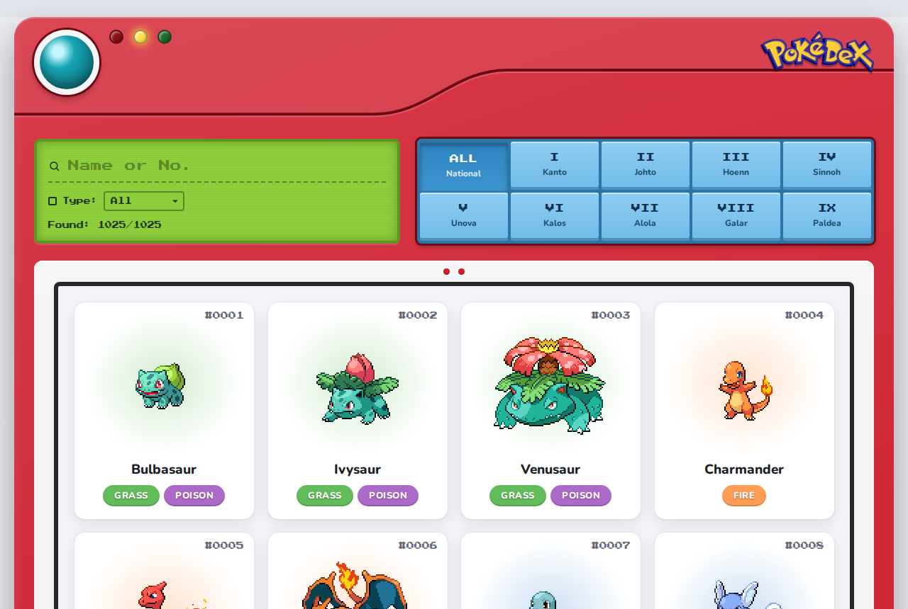
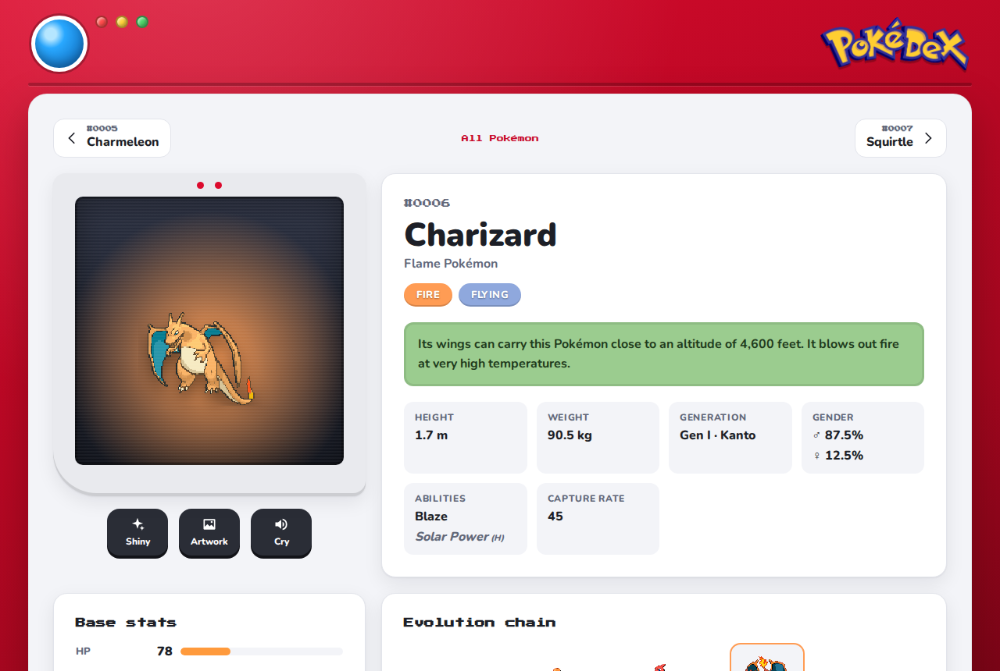
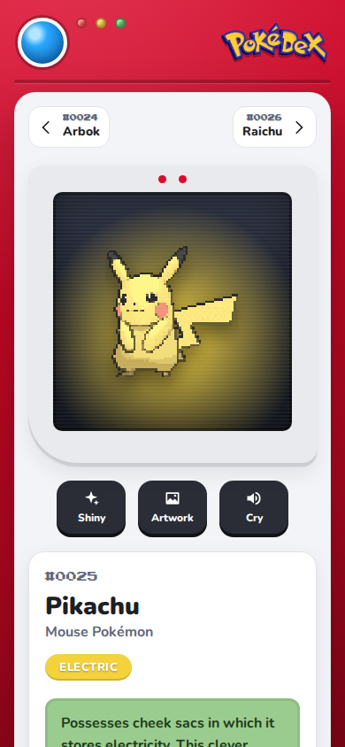

<h3 align="center">React Pokédex Catalogue</h3>

A fast, responsive Pokédex for all <strong>1025 Pokémon</strong> (Generation I to IX), made with React and Redux on top of <a href="https://pokeapi.co">PokéAPI</a>.

## Live demo

[Live demo here!](https://vichuge.github.io/react-catalogue/)

## Videos presentation

[Click here!](https://gist.github.com/vichuge/9bbb172a224718d6dc61953590f973ab)

## Features

- **Every generation**: Kanto to Paldea, 1025 Pokémon in the national dex.
- **Search** by name or national number, and **filter** by generation and type, all at once.
- **Fast list**: the whole index (names + types) comes from 19 small requests, is cached in `localStorage` for a week, and the grid renders in pages with infinite scroll and lazy-loaded sprites.
- **Detail screen**: animated sprite or official artwork, shiny toggle, cry playback, description, height, weight, gender ratio, abilities (hidden ones marked), base stats with totals and the full evolution chain (including branches such as Eevee).
- **Navigation**: previous / next Pokémon, keyboard shortcuts (← → and Esc), and the list keeps your filters and scroll position when you come back.
- Loading skeletons, empty and error states with retry, dark mode, reduced-motion support and a layout that works from phones to desktops.

## Built With

- JavaScript, HTML5, CSS3
- React 18 & React Router 6
- Redux & Redux Thunk
- Create React App (webpack), Jest & Testing Library
- ESLint (Airbnb) & Stylelint

### Prerequisites

- Node.js 18 or newer
- Text Editor (VSCode is suggested.)

### Setup

- Open Terminal
- Run `git clone https://github.com/vichuge/react-catalogue.git`
- `cd react-catalogue`
- `npm install`
- `npm start`

### Scripts

- `npm test` runs the test suite
- `npm run lint` runs ESLint and Stylelint

### Deployment

Every merge into `development` triggers the **Deploy to GitHub Pages** workflow: it runs the tests, builds the app and deploys it with the official GitHub Pages actions to the live demo URL (Settings → Pages → Source: **GitHub Actions**). It can also be run manually from the *Actions* tab.

## Author

👤 **Victor Pacheco**

- GitHub: [@vichuge](https://github.com/vichuge)
- LinkedIn: [LinkedIn](https://www.linkedin.com/in/victorpachecoflores/)

## 🤝 Contributing

Contributions, issues and feature requests are welcome! 

## Show your support

Give a ⭐️ if you like this project!

## 📝 License

This project is [MIT](./LICENSE) licensed.
